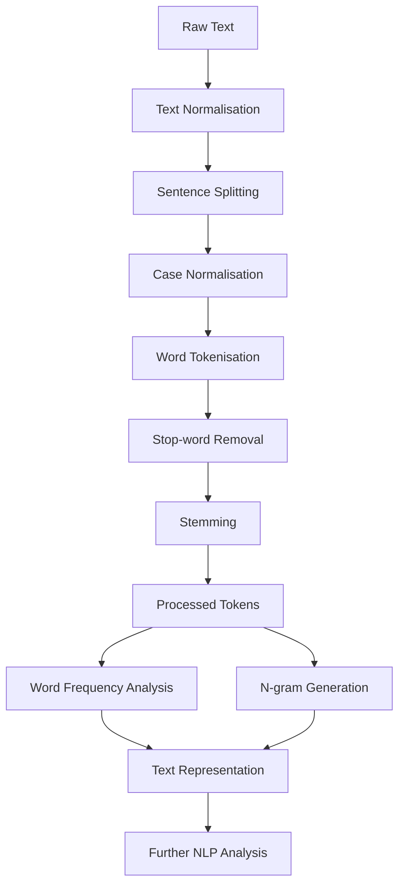

# Text Processing

## 1. Introduction

Text processing is an essential step in Natural Language Processing (NLP), as raw textual data often contains inconsistencies, unnecessary characters, and structures that need to be handled before further analysis.

This module provides a collection of text-processing functions that transform raw text into a structured representation suitable for NLP algorithms.

The library implements the following text-processing functionalities:

- Text normalisation.
- Sentence splitting.
- Word tokenisation.
- Case normalisation.
- Stop-word removal.
- Word frequency analysis.
- N-gram generation.
- Basic stemming.

Each functionality is implemented as a separate operation, allowing users to invoke them independently or combine them into a complete text-processing pipeline.

---

## 2. Text Normalisation

### 2.1 Description

Text normalisation cleans the input text by removing unwanted characters and extra whitespace. The operations are controlled through an `Option` structure, allowing users to selectively enable digit, punctuation, and special character removal.

### 2.2 Working Principle

The function `text_normalization()` performs the following operations:

1. Removes extra spaces, tabs, and newline characters, replacing consecutive whitespace with a single space.
2. Removes digits if `digit_removal` is enabled.
3. Removes punctuation marks if `punctuation_removal` is enabled.
4. Removes non-printable characters if `special_character_removal` is enabled.
5. Removes leading and trailing whitespace.

Whitespace removal is always performed, irrespective of the options selected.

### 2.3 Function Signature

```c
void text_normalization(char *text, Option opt);
```

### 2.4 Example

**Input:**
```text
"Hello!!!   NLP 123\nWorld."
```

**Options:**
- `digit_removal = 1`
- `punctuation_removal = 1`
- `special_character_removal = 1`

**Output:**
```text
"Hello NLP World"
```

### 2.5 Implementation Details

- Performs in-place modification of the input string.
- Uses standard C character-handling functions from `ctype.h`.
- Returns immediately if the input pointer is `NULL`.
- Does not allocate additional memory.

---

## 3. Sentence Splitting

### 3.1 Description

Sentence splitting is the process of dividing a paragraph or a larger text into individual sentences.

It is useful when sentence-level processing or analysis is required.

### 3.2 Working Principle

1. The input text is scanned character by character.
2. Sentence-ending punctuation marks are identified.
3. The text is divided at the identified boundaries.
4. Individual sentences are stored separately.

Common sentence-ending punctuation marks include:

- Full stop (.)
- Question mark (?)
- Exclamation mark (!)

### 3.3 Example

**Input:**
```text
"NLP is interesting. It has many applications! Do you like it?"
```

**Output:**
```text
Sentence 1: NLP is interesting.
Sentence 2: It has many applications!
Sentence 3: Do you like it?
```

---

## 4. Word Tokenisation

### 4.1 Description

Word tokenisation is the process of breaking a sentence or a document into smaller units called tokens, which generally correspond to individual words.

Tokenisation is one of the fundamental steps in NLP because most subsequent operations work on individual tokens rather than complete paragraphs.

### 4.2 Working Principle

1. The input text is scanned to identify individual words.
2. Delimiters such as spaces and punctuation are handled according to the tokenisation rules.
3. Individual tokens are extracted.
4. The resulting tokens are stored for further processing.

### 4.3 Example

**Input:**
```text
"Natural Language Processing is interesting."
```

**Output:**
```text
Token 1: Natural
Token 2: Language
Token 3: Processing
Token 4: is
Token 5: interesting
```

---

## 5. Case Normalisation

### 5.1 Description

Case normalisation converts text into a consistent letter case, usually lowercase.

This ensures that words differing only in capitalisation are treated as the same word during subsequent operations.

For example, "Apple", "APPLE", and "apple" are converted into the same representation.

### 5.2 Working Principle

1. The input text is traversed character by character.
2. Uppercase alphabetic characters are identified.
3. These characters are converted into lowercase.
4. Other characters are retained or handled according to the implementation.

### 5.3 Example

**Input:**
```text
"Natural LANGUAGE Processing"
```

**Output:**
```text
"natural language processing"
```

---

## 6. Stop-word Removal

### 6.1 Description

Stop words are commonly occurring words that often contribute relatively little information to certain NLP tasks.

Examples include:

- is
- the
- a
- an
- and
- of
- in
- to

Stop-word removal eliminates these words from the processed text to reduce unnecessary tokens and focus on more informative terms.

### 6.2 Working Principle

1. The input text is tokenised into individual words.
2. Each token is checked against a predefined collection of stop words.
3. Tokens found in the stop-word collection are removed.
4. The remaining tokens are retained for further processing.

### 6.3 Example

**Input:**
```text
"The student is studying the subject of NLP."
```

**Stop words removed:**
```text
the, is, of
```

**Output:**
```text
student studying subject NLP
```

---

## 7. Word Frequency Analysis

### 7.1 Description

Word frequency analysis determines how many times each distinct word occurs in a document or a collection of documents.

It helps identify frequently occurring terms and provides a basic statistical representation of textual data.

### 7.2 Working Principle

1. The input text is tokenised into individual words.
2. Each word is checked against the existing collection of unique words.
3. If the word already exists, its frequency is incremented.
4. Otherwise, a new entry is created with an initial frequency of one.
5. The resulting collection contains each distinct word and its corresponding frequency.

### 7.3 Example

**Input:**
```text
"data science is interesting and data science is useful"
```

**Output:**

| Word | Frequency |
|---|---:|
| data | 2 |
| science | 2 |
| is | 2 |
| interesting | 1 |
| and | 1 |
| useful | 1 |

### 7.4 Applications

- Identifying frequently occurring words.
- Building vocabulary representations.
- Generating document-term matrices.
- Supporting TF-IDF calculations and other NLP algorithms.

---

## 8. N-gram Generation

### 8.1 Description

An N-gram is a sequence of N consecutive tokens extracted from a text.

N-grams help capture relationships between neighbouring words and provide more contextual information than individual words.

The different types include:

- **Unigrams (N = 1):** Individual words.
- **Bigrams (N = 2):** Consecutive pairs of words.
- **Trigrams (N = 3):** Consecutive groups of three words.

### 8.2 Working Principle

1. The input text is tokenised into individual words.
2. A value of N is selected.
3. A sliding window of size N is moved across the token sequence.
4. The consecutive tokens within each window are combined to form an N-gram.
5. The generated N-grams are stored or returned.

### 8.3 Example

**Input:**
```text
"I love natural language processing"
```

**Unigrams:**
```text
I
love
natural
language
processing
```

**Bigrams:**
```text
I love
love natural
natural language
language processing
```

**Trigrams:**
```text
I love natural
love natural language
natural language processing
```

### 8.4 Applications

- Capturing short word sequences.
- Identifying common phrases.
- Supporting text classification.
- Improving keyword and phrase extraction.

---

## 9. Basic Stemming

### 9.1 Description

Stemming is the process of reducing words to their root or stem form by removing or modifying common word suffixes.

It helps group different variations of a word into a common representation.

For example, words such as "playing", "played", and "plays" may be reduced to "play".

### 9.2 Working Principle

1. The input word is examined for common suffixes.
2. The word is checked against the stemming rules implemented in the library.
3. Recognised suffixes are removed or modified.
4. The resulting stem is returned.

### 9.3 Example

| Input Word | Possible Stem |
|---|---|
| playing | play |
| played | play |
| studies | studi |
| running | run |

The resulting stem does not necessarily have to be a valid dictionary word.

### 9.4 Applications

- Reducing vocabulary size.
- Grouping morphological variations.
- Improving text matching.
- Supporting information retrieval and text classification.

---

## 10. Text Processing Pipeline

The individual preprocessing functions can be combined to form a complete text-processing pipeline.

A typical pipeline consists of the following stages:

1. Read the input text.
2. Perform text normalisation.
3. Split the text into sentences if required.
4. Apply case normalisation.
5. Tokenise the text into words.
6. Remove stop words.
7. Apply stemming.
8. Perform word frequency analysis or generate N-grams.
9. Pass the processed representation to the required NLP algorithm.

### 10.1 Pipeline Diagram



The pipeline is flexible. Individual functions can also be called independently, depending on the requirements of the application.

---

## 11. Conclusion

The text-processing module provides the fundamental operations required to transform raw textual data into structured representations.

By implementing normalisation, sentence splitting, tokenisation, stop-word removal, frequency analysis, N-gram generation, and stemming, the library provides a foundation for more advanced NLP operations.

These functionalities can be combined with vocabulary generation, vectorisation, classification, and similarity algorithms to perform a variety of text-analysis tasks.
